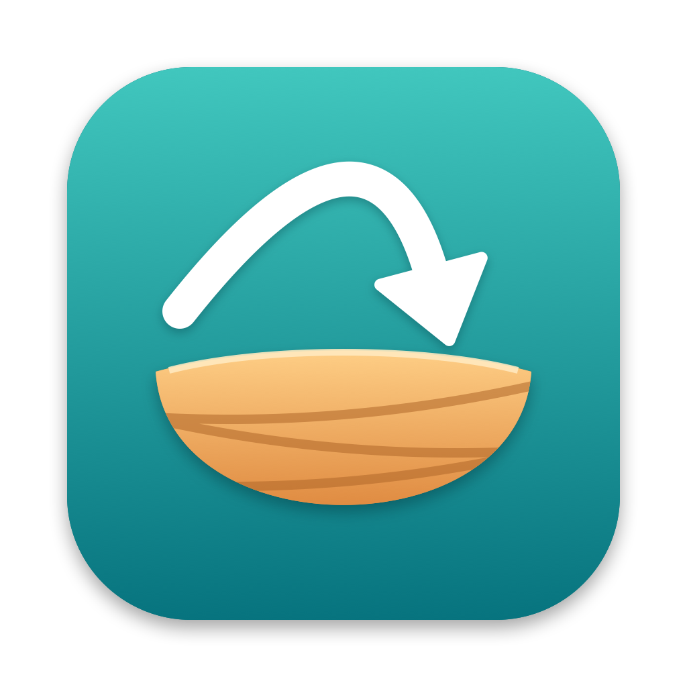

<p align="center">
  
</p>

# Crossnest

A Mac app for people who used Windows for years. It changes Mac settings with plain-English
switches, can make the Mac behave more like a PC, and explains where familiar Windows things live
on a Mac.

## Features

- **One-click preset:** "Make my Mac feel like Windows" turns on the recommended changes in one go.
- **About 45 switches** in six areas:
  - **Keyboard:** key repeat, Home and End keys, F1–F12, Tab through dialogs, auto-correct
  - **Keyboard Shortcuts:** Alt+Tab window switcher, Windows+L to lock, Ctrl+C/V/X/Z and other PC Ctrl shortcuts
  - **Mouse & Trackpad:** smooth wheel scrolling, PC-style scroll direction, no acceleration, tap to click, right-click
  - **Finder:** file extensions, path bar, status bar, list view, folders first, no .DS_Store files on shared drives
  - **Dock & Windows:** snap to screen edges, double-click to maximize, minimize into app icons, date in the menu bar
  - **General:** screenshots saved to Pictures › Screenshots, full Save dialogs, scroll bars always visible, TextEdit like Notepad
- **Undo:** the first time Crossnest changes a setting, it records the original value. Turning a switch off,
  or choosing "Undo Everything", puts that value back.
- **Restart banner:** after a change that needs Finder, the Dock or the menu bar restarted, a banner
  offers to do it, or to log out for keyboard and mouse changes.
- **Your keyboard:** works with PC keyboards in either Windows or "Mac mode" (where Alt and Windows are
  swapped). A Detect button finds out which you have. It can also reset modifier-key remapping from
  System Settings, with a restore option.
- **Mouse Lock (optional):** keeps the pointer inside a chosen app's window (or its screen) so it can't
  slide onto another monitor, like a game's "confine cursor" option. Only for the apps you pick and only
  while one is in front; switching apps releases it. Detects the window size when you add an app, with
  per-app padding and sensitivity. Works like a game's mouse capture: Crossnest positions the pointer
  itself using your learned pointer speed curve, so it never crosses the edge and never jitters. The
  menu bar icon turns blue while it's holding the pointer.
- **Menu bar icon:** while a live feature is on, Crossnest stays in the menu bar so the shortcuts keep
  working after you close the window, and it can start at login.
- **"Where is it on Mac?":** a searchable guide covering Task Manager → Activity Monitor,
  Alt+F4 → Cmd+Q, Recycle Bin → Trash and more, with buttons that open the right app or pane.

## Build and run

Requires macOS 14 or later and Swift 5.10 or later (Xcode or the Command Line Tools).

```sh
swift run                      # quick dev run, no .app bundle
scripts/bundle.sh [debug]      # build/Crossnest.app (release by default)
scripts/install.sh             # build release and install to /Applications
scripts/make-icon.sh           # regenerate Resources/AppIcon.icns from scripts/make-icon.swift
```

`bundle.sh` signs with your Apple Development or Developer ID certificate if you have one, so
macOS remembers permissions between builds. Without one it signs ad hoc.

## How it works

- `Engine/TweakCatalog.swift` lists every switch. Each switch is a set of `defaults` keys (domain,
  key, value), or a special action such as installing the key bindings file. Each key belongs to
  only one switch.
- A switch shows as on when all of its keys match. The app re-reads them whenever it comes to the
  front, so changes made in System Settings show up too.
- Original values are stored in `~/Library/Application Support/Crossnest/originals.json`.
- The Home/End switch writes `~/Library/KeyBindings/DefaultKeyBinding.dict`. If you already had one,
  it is moved aside and restored when you turn the switch off.
- Live features (Alt+Tab, Windows+L, Ctrl shortcuts, smooth scrolling) use one event tap at the HID
  level, so they can take over shortcuts such as Cmd+Tab before macOS handles them. They need
  Accessibility permission. Anything slow, like asking apps for their window list, runs off the tap's
  thread, because macOS switches a tap off if it doesn't answer quickly.
- Mouse Lock has its own event tap on a high-priority thread. While a locked app is in front it
  detaches the pointer from the mouse (`CGAssociateMouseAndMouseCursorPosition`), applies each
  movement itself scaled by a speed curve learned from normal use, clamps it to the area and warps the
  pointer there. The calibration lives in `UserDefaults` and refines itself whenever the pointer is free.
- The app is not sandboxed, because it writes other apps' preferences and restarts Finder and the
  Dock. That means it has to be distributed outside the Mac App Store, signed with a Developer ID
  and notarized.

## Roadmap

- [ ] Window previews in Alt+Tab (needs Screen Recording permission)
- [ ] Windows+arrow keys to snap and maximize windows
- [ ] Alt+F4 closes the window
- [ ] In Finder, Enter opens the selected file and Cut/Paste moves files
- [ ] Close an app when its last window closes
- [ ] Settings for smooth-scroll speed and smoothness
- [ ] First-run questionnaire that suggests settings
- [ ] Developer ID signing, notarization and a DMG for release
